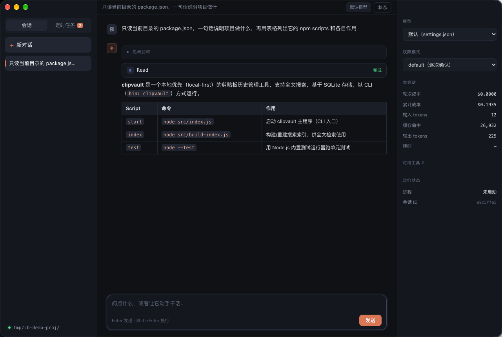
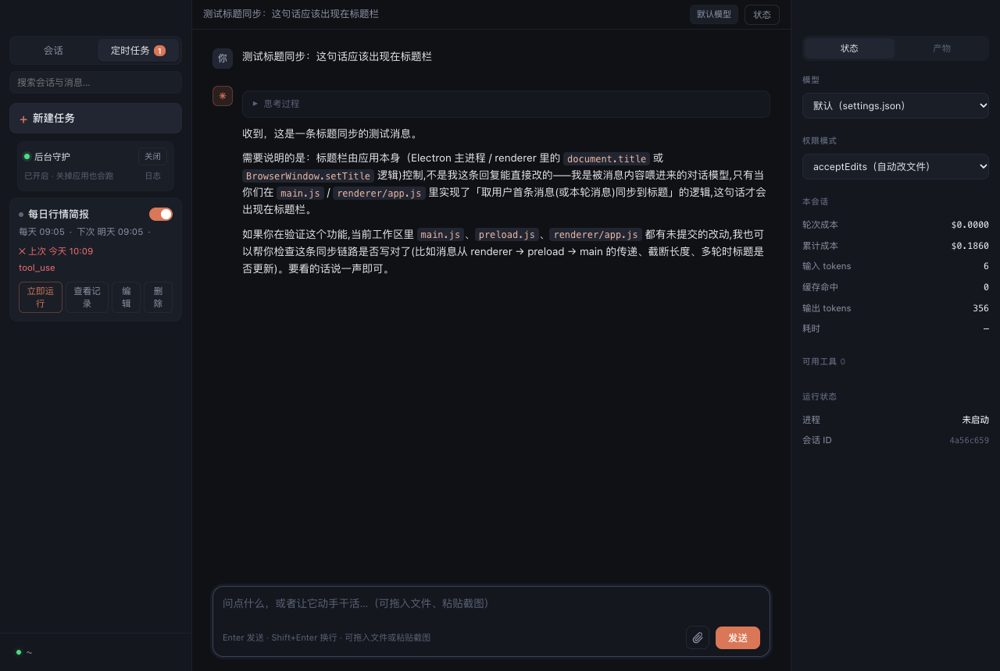
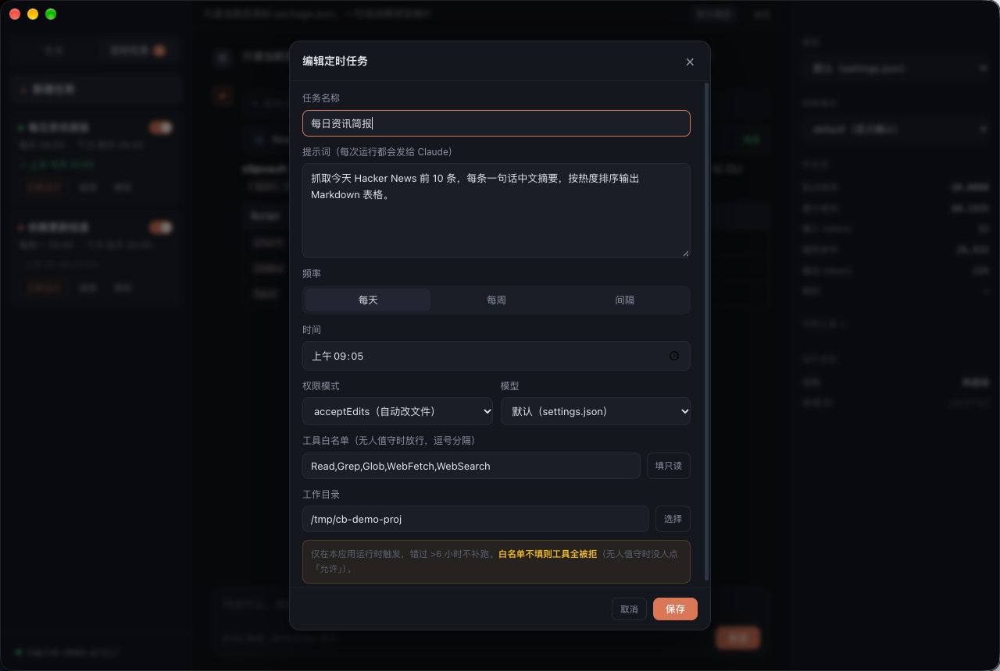

# Claude Buddy

> A macOS desktop AI agent whose runtime *is* the Claude Code CLI — not a wrapper that shells out per message, but a live bidirectional NDJSON channel to a long-running `claude` process.

**把 Claude Code CLI 直接当 runtime 用的 macOS 桌面 AI 助手。**

[](https://github.com/SingleTime/claude-buddy)
[](https://www.electronjs.org/)
[](LICENSE)
[](package.json)

---

## 这是什么

一个 Electron 桌面应用，主进程里给每个会话挂一个常驻的 `claude` 子进程，走 stdin/stdout 双向 NDJSON 流：

```
claude -p --input-format stream-json --output-format stream-json \
          --include-partial-messages --verbose \
          --permission-mode <mode> [--resume <session_id>] [--model <m>]
```

不是"发一条消息 → 起一个进程 → 等它结束 → 关掉"那种套壳。一个进程吃多轮，首轮从 `system/init` 取 `session_id`，后续 `--resume` 恢复，冷启动开销只付一次。

因为 harness 就是 Claude Code 本身，**已有的 skills、MCP、settings、模型配置全部直接复用**，不需要迁移或重新适配。



---

## 为什么不用现成的

现成的桌面 AI 助手大多是封闭的：harness 不可换、模型出口不可换、MCP 凭据由平台代管、成本不透明。

这个项目的取向很简单：

| 维度 | 做法 |
|---|---|
| **harness** | 就是 Claude Code CLI，可审计、可替换、可改 |
| **模型** | 完全自由。改 `~/.claude/settings.json` 指向任何 Anthropic 兼容端点即可，当前跑的是 `qwen3.8-flash`（1M 上下文） |
| **云端依赖** | 无。直连你自己配的端点，不需要任何平台账号 |
| **skills / MCP** | 直接读 `~/.claude/skills` 和 `~/.claude.json` 里的 MCP 配置 |
| **成本可见性** | 每轮 token / 缓存命中 / 美元成本 / API 耗时，逐轮记账 |

代价是生态还在早期：没有专家体系、没有多端同步、定时任务依赖主进程存活。这是一版**能日常用**的东西，不是成品。

---

## 功能

- **多会话** — 左栏列表，自动持久化，重启恢复
- **流式输出** — 逐字打字机，含 thinking 增量
- **思考过程** — 折叠块，可展开
- **工具调用卡片** — 工具名 / 参数 JSON / 执行结果 / 成功失败状态，可折叠
- **Markdown 渲染** — 标题、列表、代码块、表格、引用、链接
- **模型切换** — 右栏下拉，改完自动重启进程生效
- **权限模式** — `default` / `plan` / `acceptEdits` / `bypassPermissions`
- **工作目录** — 左下角点选，决定 agent 的操作根目录
- **成本面板** — 本轮成本、累计成本、输入输出 token、缓存命中、耗时
- **工具清单** — 右栏列出当前会话可用工具（含 MCP）
- **定时任务** — 按天 / 按周 / 按间隔自动跑，结果落进独立会话

---

## 快速开始

### 前置条件

1. **macOS 12+**（Apple Silicon 或 Intel）
2. **Node.js 18+**
3. **Claude Code CLI** 已安装并完成认证 —— 没装也没关系，应用会引导你装（见下）

> Claude Code 是 Anthropic 的闭源商业产品，**不随本仓库分发**。这个项目是它的前端，
> 自己装一份即可，应用会自动找到。想手动装：
>
> ```bash
> npm install -g @anthropic-ai/claude-code
> curl -fsSL https://claude.ai/install.sh | bash
> ```

验证：

```bash
claude --version
claude -p "say hi"     # 能出结果说明认证 OK
```

应用会自动在 `/opt/homebrew/bin`、`/usr/local/bin`、`~/.claude/local`、`~/.local/bin` 等常见位置找 `claude`。装在别处就用环境变量指定：

```bash
CLAUDE_BIN=/your/path/to/claude npm start
```

### 安装运行

```bash
git clone https://github.com/SingleTime/claude-buddy.git
cd claude-buddy
npm install
./start-claude-buddy.command      # 或双击
```

也可以 `npm start`。

> **注意**：如果终端里设了 `ELECTRON_RUN_AS_NODE=1`（某些 Electron 应用会往子进程注入），
> 必须先 `unset ELECTRON_RUN_AS_NODE`，否则 Electron 会退化成 Node 跑，报 `whenReady undefined`。
> `start-claude-buddy.command` 里已经处理。

### 没装 Claude Code？让应用自己装

启动时找不到 `claude`，会弹一个三选一的对话框：

| 选项 | 行为 |
|---|---|
| **自动安装** | 打开安装向导，跑官方 `curl` 脚本，实时显示进度；装完自动重新探测并接管 |
| **手动安装说明** | 跳到官方文档 |
| **稍后** | 关掉对话框，之后可从菜单「帮助 → 安装 Claude Code…」重新打开 |

安装向导里有两个方法可随时切换 —— 官方脚本（不需要 Node）和 `npm install -g`（适合已经把 Node 管起来的人，装完落在 npm 全局 bin）。命令执行完会**重新扫描磁盘**，只有真的找到可执行文件才报成功；否则如实说明是「退出码 0 但没产出文件」还是「退出码非 0」，并允许换个方法重试。整个过程不写任何配置文件、不改 shell profile。

失败排查看向导里的日志区：`sys:` 是执行的命令，`out:` 是标准输出，`err:` 是标准错误（红色）。常见原因是没有 npm、或全局 bin 目录没权限 —— 这时切到官方脚本一般能绕过。

### 换成非官方模型端点

默认沿用 `~/.claude/settings.json` 的配置。想指向别的 Anthropic 兼容服务，在那里加 `env`：

```json
{
  "env": {
    "ANTHROPIC_BASE_URL": "https://your-endpoint.example.com/anthropic",
    "ANTHROPIC_AUTH_TOKEN": "your-token",
    "ANTHROPIC_MODEL": "your-model-name",
    "ANTHROPIC_DEFAULT_SONNET_MODEL": "your-model-name",
    "ANTHROPIC_DEFAULT_HAIKU_MODEL": "your-model-name",
    "CLAUDE_CODE_MAX_CONTEXT_TOKENS": "1000000"
  }
}
```

四档 `_DEFAULT_*_MODEL` 和 `ANTHROPIC_MODEL` 要一起改，否则内部小任务（标题生成之类）会走到别的模型上。改完重启应用，右栏下拉会显示实际模型名。

---

## 架构

```
┌─────────────────────────────────────────┐
│ 渲染进程 (renderer/app.js)               │
│  会话列表 / 消息流 / 工具卡片 / 状态面板   │
└──────────────┬──────────────────────────┘
               │ IPC (preload 白名单)
┌──────────────▼──────────────────────────┐
│ 主进程 (main.js)                          │
│  · 会话持久化 userData/sessions.json      │
│  · 每个会话一个常驻 claude 子进程          │
│  · 定时任务调度器                          │
└──────────────┬──────────────────────────┘
               │ NDJSON over stdio
┌──────────────▼──────────────────────────┐
│ claude CLI (stream-json 双向通道)         │
│  skills / MCP / permission 全由它负责      │
└─────────────────────────────────────────┘
```

事件流被翻译成 UI 友好的增量：

| 原始事件 | 用途 |
|---|---|
| `system/init` | 拿 `session_id`、模型名、可用工具清单 |
| `stream_event/content_block_delta` | 打字机效果（text / thinking / tool 参数） |
| `assistant` | 完整消息，用于校正 |
| `user`（含 `tool_result`） | 工具执行结果回填卡片 |
| `result` | 成本、耗时、token、缓存命中 |

---

## 定时任务

左栏顶部切到「定时任务」→「新建任务」。



| 配置项 | 说明 |
|---|---|
| 提示词 | 每次运行发给 Claude 的内容。**要写成能被独立执行的指令**，它看不到你之前的对话 |
| 频率 | 每天（指定时刻）/ 每周（多选星期）/ 间隔（每 N 分钟） |
| 工具白名单 | **最关键的一项**，见下文 |
| 权限模式 | 默认 `acceptEdits` |
| 工作目录 | 任务的执行根目录 |



### 为什么必须给工具白名单

无人值守时没人点「允许」，而且 `acceptEdits` **不放行 MCP 和 Bash**。实测：

```bash
$ claude -p "查 03690" --permission-mode acceptEdits
未取到数据：mcp__finance-data__quote 的调用权限尚未授予…

$ claude -p "查 03690" --permission-mode acceptEdits --allowedTools "mcp__finance-data__quote"
03690  HK  71.85  -2.20  -2.97%
```

不给白名单，任务能"跑完"、退出码 0，但模型只会回一句"权限尚未授予"。

所以新建任务时已预填一份只读白名单（`Read/Grep/Glob/WebFetch/WebSearch` + 你 MCP 里的只读工具）。需要写文件就手动加 `Write`、`Edit`，要执行 Shell 加上 `Bash`——**想清楚再放，这条命令会在你不看着的时候跑**。

### 调度行为

- **精度** — 10 秒轮询，实测 1 分钟间隔的实际间隔为 60 秒整
- **错过不补跑** — 关机 / 休眠超过 6 小时的任务，醒来后直接跳过并留一条 `skipped` 记录
- **不堆叠** — 上一次还在跑就顺延到下一周期
- **超时** — 单次运行超过 15 分钟强制终止并记为失败
- **会话隔离** — 每个任务固定一个 `⏱ 任务名` 会话，历史都堆在那里
- **上下文干净** — 每次运行都是新进程 + 不 `--resume`，避免上下文逐日膨胀推高成本

**建好之后先点一次「立即运行」**，确认输出确实是你想要的那个东西，再启用。定时任务无人值守，跑歪了不会有人当场发现。

---

## 踩过的坑

都是真踩出来的，记下来省后来人时间。

**1. `ELECTRON_RUN_AS_NODE=1` 让 Electron 退化成 Node**

从别的 Electron 应用继承环境变量启动时，`electron .` 直接报：

```
TypeError: Cannot read properties of undefined (reading 'whenReady')
```

启动前 `unset ELECTRON_RUN_AS_NODE` 即可。

**2. 一轮对话有多个 `message_start`**

模型调用工具后会继续输出，产生第二个 `message_start`。最初在这个事件里清空累积状态，导致工具卡片被抹掉、历史恢复后 tools 数组为空。修法：`message_start` 只重置当前块指针，`text/thinking/tools` 是**整轮**累积的，不能清。

**3. 渲染层同理**

`turn_start` 不能无条件清空容器，否则工具执行后的文字会把前面的卡片冲掉。用 `started` 标志区分首次与后续。

**4. `app.setName()` 改不了菜单栏**

开发模式下 macOS 菜单栏第一项来自 `Electron.app` 的 `CFBundleName`，只能靠打包时设置 `productName` 才变。

**5. 权限被拒时退出码仍是 0**

工具被拦时 Claude 不报错，而是正常返回一段"请先批准"的文字。只看 `is_error` 会误判成成功。所以任务完成时会对响应文本做一次关键字匹配（`权限提示` / `待批准` / `not granted` 等），命中就在卡片上打黄色警告。

**6. `lastRunAt` 记成了完成时间**

第一版在任务结束时才写 `lastRunAt`，运行耗时被算进间隔里，实测"每 60 秒"看起来像 102 秒。改成记触发时刻，`runs[]` 里另存 `finishedAt` 和 `elapsedMs`。

**7. 从 Finder 启动拿不到 shell 的 PATH**

GUI 应用的 `PATH` 通常只有 `/usr/bin:/bin:/usr/sbin:/sbin`，Homebrew 装的 `claude` 找不到。启动时先探常见安装路径，再拼一份补全的 `PATH` 传给子进程。

**8. 内容跑题检测不出来**

见过两类偶发问题，都不是配置错误：回复"本会话没有该工具"（MCP 冷启动超时，工具没挂上）、回复内容完全无关（模型侧偶发跑偏）。程序只能对权限类文字打黄色警告，**内容跑题没法自动判断**，只能偶尔翻「查看记录」。

**9. `CLAUDE_BIN` 指错了会把自己的自动安装坑死**

原逻辑「设了 `CLAUDE_BIN` 就无条件用它」有个死循环：用户填了一个不存在的路径 → 应用提示找不到 → 引导自动安装 → 装成功了，但下一轮仍然用那个错路径 → 还是找不到。改成先验证存在才采纳，失效就退回自动探测。

**10. 安装命令退出码 0 不等于装好了**

`curl | bash` 可能因为权限、网络或镜像问题中途放弃却返回 0。所以判定成功不靠退出码，而是**重新扫一遍磁盘**，真找到可执行文件才算成功；没找到就按退出码区分两种原因分别提示。

---

## 已知限制

| 项 | 说明 |
|---|---|
| 平台 | 仅 macOS。Windows / Linux 未适配（Electron 本身跨平台，但路径与进程管理要改） |
| 代码签名 | 未签名。自行打包后首次打开需右键 → 打开，或 `xattr -dr com.apple.quarantine` |
| 权限确认 | `default` 模式下需要确认的工具在 headless 通道里会被直接拒绝，不会弹窗问你。想让它自己干活用 `acceptEdits` |
| 会话搜索 | 未做 |
| 定时任务依赖主进程 | ⌘Q 退出后不再触发；"错过超过 6 小时"的任务不补跑 |
| 任务并发 | 多个任务同时到点会各自起一个 claude 进程，没有全局并发上限 |
| 任务通知 | 只落进应用内，没有系统通知 |

---

## 路线图

- [ ] 系统通知（定时任务完成 / 失败）
- [ ] 全局任务并发上限
- [ ] 会话全文搜索
- [ ] 用 `launchd` 托管，脱离主进程跑定时任务
- [ ] 打包脚本 + Release 产物
- [ ] Windows / Linux 适配

---

## 文件结构

```
claude-buddy/
├── main.js                     Electron 主进程 + claude 进程管理 + 事件解析 + 任务调度
├── preload.js                  contextBridge 白名单 API
├── renderer/
│   ├── index.html              三栏布局 + 任务弹窗
│   ├── style.css               深色主题
│   ├── app.js                  markdown 渲染 / 流式打字 / 工具卡片 / 会话与任务管理
│   └── installer.html          Claude Code 安装向导
├── start-claude-buddy.command  双击启动（已处理环境变量）
├── assets/                     截图
└── package.json
```

调度相关代码在 `main.js` 的「定时任务调度」一节：`computeNext`（算下次时间）、`runTask`（起进程执行）、`finishTaskRun`（收口记账）、`startScheduler`（10 秒轮询）。任务数据跟会话存在同一个 `sessions.json` 里，字段是 `tasks[]`。

会话数据在 `~/Library/Application Support/Claude Buddy/sessions.json`。

---

## 许可

[MIT](LICENSE)

本项目是 Claude Code CLI 的独立前端，与 Anthropic 无关联。使用前请自行确认你对所接入模型服务的使用条款。
