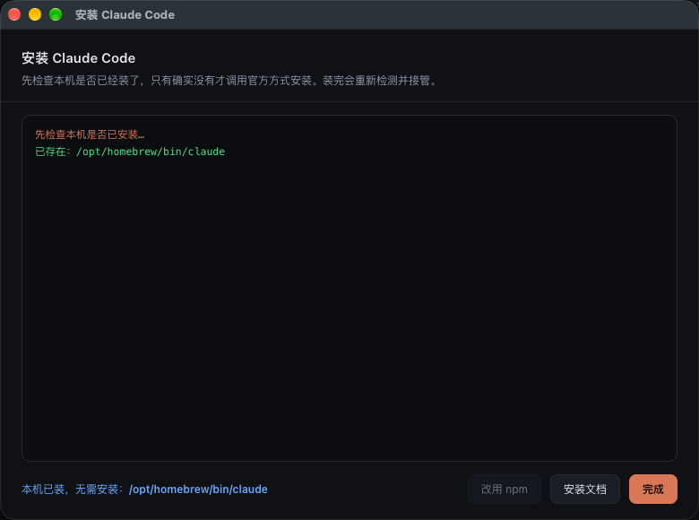

# Claude Buddy

> A macOS desktop AI agent whose runtime *is* the Claude Code CLI — not a wrapper that shells out per message, but a live bidirectional NDJSON channel to a long-running `claude` process.

**English** · [简体中文](README.zh-CN.md)

[](https://github.com/SingleTime/claude-buddy)
[](https://www.electronjs.org/)
[](LICENSE)
[](package.json)

---

## What this is

An Electron app that keeps one long-lived `claude` subprocess per session and talks to it over stdin/stdout:

```
claude -p --input-format stream-json --output-format stream-json \
          --include-partial-messages --verbose \
          --permission-mode <mode> [--resume <session_id>] [--model <m>]
```

This is not the "send a message → spawn a process → wait → kill it" pattern. One process serves many turns: the first turn picks up `session_id` from `system/init`, later turns `--resume` it, and you pay the cold-start cost once.

Because the harness *is* Claude Code, **your existing skills, MCP servers, settings and model configuration all carry over unchanged.**


---

## Why not an existing app

Most desktop AI assistants are closed boxes: the harness can't be swapped, the model endpoint can't be swapped, MCP credentials are held by the vendor, and cost is opaque.

This project takes the opposite position:

| Dimension | Approach |
|---|---|
| **Harness** | It is the Claude Code CLI — auditable, replaceable, patchable |
| **Model** | Fully free. Point `~/.claude/settings.json` at any Anthropic-compatible endpoint; this instance currently runs `qwen3.8-flash` (1M context) |
| **Cloud dependency** | None. You talk straight to the endpoint you configured — no platform account |
| **Skills / MCP** | Read directly from `~/.claude/skills` and the MCP block in `~/.claude.json` |
| **Cost visibility** | Per-turn tokens, cache hits, USD cost and API latency, accounted turn by turn |

The trade-off is an immature ecosystem: no expert marketplace, no cross-device sync, and no Windows/Linux port yet. This is a **daily-driver hook**, not a finished product.

---

## Features

- **Multiple sessions** — sidebar list, auto-persisted, restored on relaunch
- **Streaming output** — token-by-token typewriter, including thinking deltas
- **Thinking blocks** — collapsible, expandable
- **Tool cards** — tool name, argument JSON, result, success/failure state, collapsible
- **Attachments** — drag in, click the paperclip, or `⌘V` a screenshot; images go to the model as inline content blocks, other files land in the session directory and are handed to `Read`
- **Artifact panel** — right sidebar lists every file written this turn; images and text preview inline, everything else opens in the system app
- **Message queue** — messages sent mid-generation aren't dropped or interleaved; they queue and fire when the current turn ends
- **Session search** — full-text search over titles and bodies, click a hit to jump
- **Markdown rendering** — headings, lists, code blocks, tables, quotes, links
- **Model switching** — dropdown in the right panel, restarts the process to take effect
- **Permission modes** — `default` / `plan` / `acceptEdits` / `bypassPermissions`
- **Working directory** — picker in the bottom left, sets the agent's root
- **Cost panel** — per-turn and cumulative cost, input/output tokens, cache hits, duration
- **Tool inventory** — right panel lists tools available to the session, MCP included
- **Scheduled tasks** — daily / weekly / interval, results land in their own session
- **Background daemon** — a LaunchAgent runs tasks even when the app is closed or was never started; no resident process, woken on schedule, exits right after
- **Missing-dependency recovery** — if `claude` isn't found, the app probes your login shell, then offers a guided install into an app-private directory that touches nothing system-wide

---

## Install

### Option 1 — download the app

Grab the `.dmg` from [Releases](https://github.com/SingleTime/claude-buddy/releases), drag it to `/Applications`.

The build is **unsigned and unnotarized**, so Gatekeeper will block the first launch. Clear the quarantine flag once:

```bash
xattr -dr com.apple.quarantine "/Applications/Claude Buddy.app"
```

Or: try to open it, then allow it in **System Settings → Privacy & Security → Open Anyway** on macOS 15+. The old "right-click → Open" shortcut no longer exists in Sequoia and later.

### Option 2 — from source

```bash
git clone https://github.com/SingleTime/claude-buddy.git
cd claude-buddy
npm install
./start-claude-buddy.command      # or double-click it
```

`npm start` works too.

> If your shell exports `ELECTRON_RUN_AS_NODE=1` (some Electron apps inject it into children), unset it first or Electron degrades into plain Node and dies with `whenReady undefined`. `start-claude-buddy.command` already handles this.

### Requirements

1. **macOS 12+** (Apple Silicon or Intel)
2. **Node.js 18+** — only for Option 2, the packaged app bundles its own runtime
3. **Claude Code CLI**, installed and authenticated

Claude Code is a closed-source commercial product of Anthropic and is **not redistributed here**. This repo is a front-end for it. To install it yourself:

```bash
npm install -g @anthropic-ai/claude-code
# or
curl -fsSL https://claude.ai/install.sh | bash
```

Verify with:

```bash
claude --version
claude -p "say hi"     # any output means auth is fine
```

Lookup order at runtime: `CLAUDE_BIN` → **app-private runtime** → `/opt/homebrew/bin`, `/usr/local/bin`, `~/.claude/local`, `~/.local/bin`, nvm/fnm version dirs → login-shell `PATH`. Override explicitly if it lives elsewhere:

```bash
CLAUDE_BIN=/your/path/to/claude npm start
```

### Let the app install Claude Code for you

If `claude` is missing at startup, a three-way dialog appears: **auto-install** (guided wizard with live progress), **manual instructions**, or **later** (reopen via *Help → Install Claude Code…*).

The wizard offers two methods, switchable at any time:

| Method | Command | When |
|---|---|---|
| **npm, app-private** | `npm install --prefix <runtime-dir> @anthropic-ai/claude-code` | Default when npm exists; installs into the app's own directory |
| **Official script** | `curl -fsSL https://claude.ai/install.sh \| bash` | Fallback without Node; only writes to `~/.local/bin` |

**It never installs globally.** `npm install -g` would drop 260 MB into whatever prefix happens to be active — `/opt/homebrew`, `/usr/local` (needs sudo with the official Node pkg), or an nvm version directory that vanishes when you switch Node versions. `--prefix` writes into the app's own runtime instead:

| Context | Runtime directory |
|---|---|
| Development (`npm start`) | `<project>/.claude-runtime` (gitignored) |
| Packaged `.app` | `~/Library/Application Support/Claude Buddy/runtime` |
| Custom | `CLAUDE_BUDDY_RUNTIME=/some/dir npm start` |

No global prefix, no shell profile edits, no `PATH` mutation, no privilege escalation. Uninstalling is `rm -rf` on that one directory.

The wizard checks before it installs: static paths first, then your **login shell** (`$SHELL -lc 'command -v claude'`, which catches nvm/fnm/asdf/volta installs a GUI process can't see), and only then runs a command. If Claude Code is already present it says so and downloads nothing.

After the command finishes it **rescans the disk** rather than trusting the exit code — `curl | bash` can bail halfway and still return 0. Failure reason is reported as "exit 0 but no file produced", "binary not unpacked", or "non-zero exit", and you can retry with the other method.



---

## Bringing your own model endpoint

By default the app inherits `~/.claude/settings.json`. To point it at another Anthropic-compatible service, add an `env` block there:

```json
{
  "env": {
    "ANTHROPIC_BASE_URL": "https://your-endpoint.example.com/anthropic",
    "ANTHROPIC_AUTH_TOKEN": "your-token",
    "ANTHROPIC_MODEL": "your-model-name",
    "ANTHROPIC_DEFAULT_SONNET_MODEL": "your-model-name",
    "ANTHROPIC_DEFAULT_HAIKU_MODEL": "your-model-name",
    "CLAUDE_CODE_MAX_CONTEXT_TOKENS": "1000000"
  }
}
```

Change all four `_DEFAULT_*_MODEL` slots *and* `ANTHROPIC_MODEL` together — otherwise internal side tasks (title generation and friends) silently route to a different model. Restart the app; the dropdown shows the resolved model name.

---

## Scheduled tasks

Switch the sidebar to **Scheduled** → **New Task**.


| Field | Notes |
|---|---|
| Prompt | What gets sent each run. **Write it as a standalone instruction** — it sees none of your prior conversation |
| Frequency | Daily (at a time) / Weekly (multi-select days) / Interval (every N minutes) |
| Tool allowlist | **The critical one**, see below |
| Permission mode | Defaults to `acceptEdits` |
| Working directory | Execution root for the task |

### Why the tool allowlist is mandatory

Nobody clicks "Allow" in an unattended run, and `acceptEdits` **does not cover MCP or Bash**. Measured:

```bash
$ claude -p "quote 03690" --permission-mode acceptEdits
No data: permission to call mcp__finance-data__quote has not been granted…

$ claude -p "quote 03690" --permission-mode acceptEdits --allowedTools "mcp__finance-data__quote"
03690  HK  71.85  -2.20  -2.97%
```

Without an allowlist the task "succeeds", exits 0, and the model just replies that permission wasn't granted.

New tasks come prefilled with a read-only allowlist (`Read/Grep/Glob/WebFetch/WebSearch` plus the read-only tools in your MCP set). Add `Write`/`Edit` to let it modify files, `Bash` to let it run shell commands — **think first, this runs while you're not watching.**

### Scheduling behaviour

- **Precision** — 10 s polling in-app, a 60 s interval measures exactly 60 s
- **No catch-up** — tasks missed by more than 6 hours (shutdown/sleep) are skipped and logged as `skipped`
- **No stacking** — if the previous run is still going, the next cycle slips
- **Timeout** — a single run is killed at 15 minutes and recorded as failed
- **Session isolation** — each task owns one `⏱ <name>` session where all its history accumulates
- **Clean context** — every run is a fresh process with no `--resume`, so context doesn't compound day over day and inflate cost

**Hit "Run now" once before enabling a task.** Unattended means nobody notices when it goes wrong.


### Running with the app closed

The task panel has a **Background daemon** status bar. Once installed, tasks fire on schedule even when the app was never launched.

`~/Library/LaunchAgents/com.claudebuddy.tasks.plist` asks launchd to invoke `runner.js` every 60 seconds; it does work only for tasks that are due, otherwise exits immediately (~0.3 s idle). This is deliberately **not** a resident daemon — a resident process would contend with the app over the same `sessions.json`, and concurrent writers lose data.

Exactly one scheduler is the invariant, arbitrated by a disk lock:

| State | Who schedules |
|---|---|
| App running | In-app timer (10 s precision); the background runner can't take the lock and exits |
| App closed | `runner.js` under launchd (60 s precision) |
| App starting while background is mid-run | App defers, retries every 3 s, reloads from disk, then takes over |

The lock file is `scheduler.lock` and records a pid. After a crash or `kill -9` the lock is stale, but the runner checks whether the pid is alive and reclaims it — verified by force-killing the app and watching the next cycle pick the task back up.

Inspect the runner's own view:

```bash
npm run doctor
```

It prints the directory it reads, the `claude` it resolved, current lock ownership, and each task's next run time. Logs live at `~/Library/Application Support/Claude Buddy/logs/runner.log`; the **Log** button on the status bar opens them. `runner.err` is kept separate — it mostly holds one harmless warning about unsigned Electron binaries under launchd.

Turn it off with **Disable** on the status bar; the plist and the launchd job are both removed with no residue.

---

## Architecture

```
┌─────────────────────────────────────────┐
│ Renderer (renderer/app.js)              │
│  sessions / message stream / tool cards │
└──────────────┬──────────────────────────┘
               │ IPC (preload allowlist)
┌──────────────▼──────────────────────────┐
│ Main (main.js)                          │
│  · persistence  userData/sessions.json  │
│  · one long-lived claude child/session  │
│  · task scheduler                       │
└──────────────┬──────────────────────────┘
               │ NDJSON over stdio
┌──────────────▼──────────────────────────┐
│ claude CLI (bidirectional stream-json)  │
│  skills / MCP / permissions: all here   │
└─────────────────────────────────────────┘
```

Raw events are translated into UI deltas:

| Raw event | Used for |
|---|---|
| `system/init` | `session_id`, model name, available tools |
| `stream_event/content_block_delta` | Typewriter effect (text / thinking / tool args) |
| `assistant` | Full message, used for correction |
| `user` (with `tool_result`) | Fills in tool card results |
| `result` | Cost, duration, tokens, cache hits |

---

## Known limitations

| Item | Detail |
|---|---|
| Platform | macOS only. Windows/Linux untested — Electron is portable, the path and process handling isn't |
| Code signing | Unsigned. Clear quarantine with `xattr -dr com.apple.quarantine` after downloading |
| Permission prompts | In `default` mode, tools that need confirmation are simply refused on the headless channel — no dialog appears. Use `acceptEdits` to let it work on its own |
| Daemon precision | launchd polls every 60 s, so actual fire time can be up to a minute off |
| No catch-up | Tasks missed by more than 6 hours are skipped and marked `skipped` |
| Daemon is macOS-only | Built on launchd; no equivalent for Windows/Linux |
| Task concurrency | Simultaneously due tasks each spawn their own `claude`; there's no global cap |
| Notifications | Results stay in-app; no system notifications |
| Artifact detection | Only `Write`/`Edit`-style `file_path` values count; files created via `Bash` redirection don't appear |
| Queue is volatile | Pending messages live in memory and vanish on session switch or quit |
| Private runtime is app-only | The runtime the app installs isn't on `PATH`; `claude` in a terminal won't see it. Install a global copy if you need one — the app prefers its own |

---

## Roadmap

- [ ] System notifications (task finished / failed)
- [ ] Global task concurrency cap
- [ ] Packaged release artifacts + CI
- [ ] Windows / Linux support

---

## Repository layout

```
claude-buddy/
├── main.js                     Electron main + claude process mgmt + event parsing + scheduler
├── runner.js                   Headless executor (invoked by launchd, no window, plain node)
├── lib/
│   ├── schedule.js             Next-run computation / due & stale checks
│   ├── claude-bin.js           Locate claude, patch PATH, probe login shell
│   └── launchd.js              LaunchAgent install / uninstall / status
├── preload.js                  contextBridge allowlist
├── renderer/
│   ├── index.html              Three-pane layout + task modal
│   ├── style.css               Dark theme
│   ├── app.js                  Markdown, streaming, tool cards, sessions & tasks
│   └── installer.html          Claude Code install wizard
├── start-claude-buddy.command  Double-click launcher (handles env vars)
├── assets/                     Screenshots
├── .claude-runtime/            App-private claude (generated, gitignored)
└── package.json
```

The two things that must never drift between the app and the background runner are extracted into `lib/` and shared by both: `schedule.js` (`computeNext`, `dueState`) and `claude-bin.js` (`resolve`, `childEnv`, `probeViaShell`). Task data lives alongside sessions in `sessions.json` under `tasks[]`.

Session data: `~/Library/Application Support/Claude Buddy/sessions.json`.

---

## Field notes

Seventeen real bugs and their fixes — permission prompts returning exit 0, multiple `message_start` events per turn, stale `CLAUDE_BIN` causing an install loop, a 500-byte stub binary passing an `exists + chmod` check, attachment directories outside cwd tripping `Read` permissions, a `close` handler that never fires in headless mode, two schedulers racing on one JSON file — are documented in the Chinese README under [踩过的坑](README.zh-CN.md#踩过的坑).

---

## License

[MIT](LICENSE)

An independent front-end for the Claude Code CLI, unaffiliated with Anthropic. Check the terms of whichever model service you point it at.
